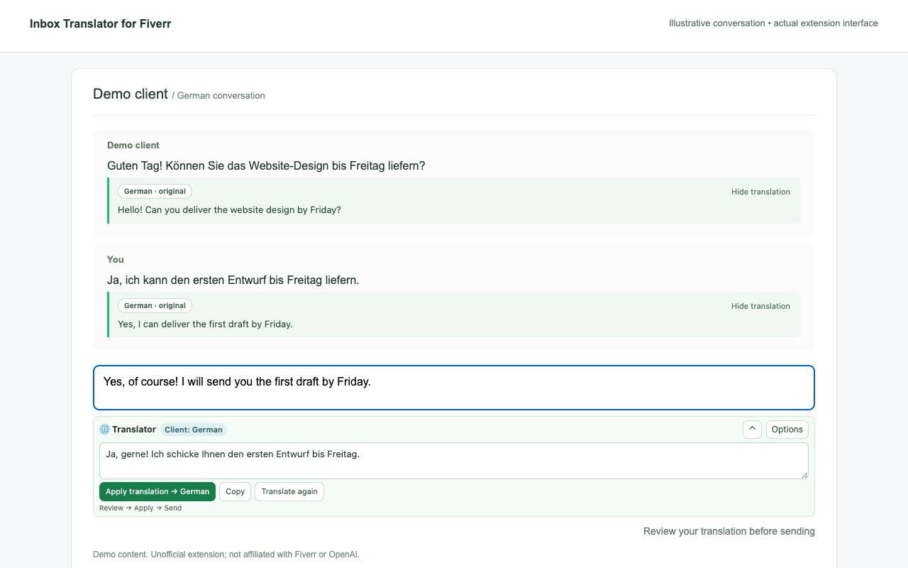

# Fiverr Inbox Translator — Chrome Extension

**Translate Fiverr inbox messages and draft replies with automatic language detection, your own OpenAI API key, and a persistent local translation cache.**

Read client conversations in your preferred language and prepare replies in the client's language directly inside the Fiverr inbox. The compact interface is designed for smaller laptop screens.

**[Download v1.1.0](https://github.com/lukapaunovic/fiverr-inbox-translator-chrome-extension/releases/latest)** · **[Installation](#install-the-chrome-extension)** · **[Privacy](docs/PRIVACY.md)** · **[Report a bug](https://github.com/lukapaunovic/fiverr-inbox-translator-chrome-extension/issues)**

> Independent project. Not affiliated with or endorsed by Fiverr or OpenAI. Requires your own OpenAI API key and available API funding or applicable credits. Version 1.1.0 was submitted to the Chrome Web Store under publisher **DCX** on November 3, 2026. Status: **pending review**, with automatic publication after approval. It is not yet live in the store; the GitHub download is available now.



## Features

- **Automatic language detection:** reply previews follow the latest confidently detected client language. Short acknowledgments such as “OK” do not replace a reliable language choice.
- **Multilingual Fiverr conversations:** translate received messages and your previously sent messages while preserving the original text and language label.
- **Browser-language default:** the initial reading language follows Chrome. Choose another language or script variant in Options.
- **Broad language selection:** more than 150 language and variant options were verified in the test browser. The available labels depend on Chromium's language data; translation quality varies by language and dialect.
- **Per-conversation reply language:** override automatic detection when a client prefers another language.
- **Local translation cache:** identical source text, target language and model reuse saved translations across page refreshes and browser restarts.
- **Compact layout:** a small toolbar expands into an editable reply preview. Additional controls stay under Options.
- **Right-to-left text support:** translation fields automatically follow text direction for languages such as Arabic and Hebrew.
- **Review before sending:** apply the translation to your Fiverr draft, edit it if needed, and click Fiverr Send yourself.
- **Bring your own API key:** no shared key, publisher proxy, subscription to this project, or analytics service is included.

The extension interface is available in English and Serbian. Translation targets are not limited to these two interface languages.

## Install the Chrome extension

1. Download **`fiverr-inbox-translator-v1.1.0.zip`** from [Releases](https://github.com/lukapaunovic/fiverr-inbox-translator-chrome-extension/releases/latest).
2. Extract the ZIP into a folder you intend to keep.
3. Open `chrome://extensions` in Chrome and enable **Developer mode**.
4. Click **Load unpacked** and select the extracted folder containing `manifest.json`.
5. In Settings, enter your own OpenAI API key, review the data notice, enable translation, and click **Save**.
6. Open or refresh a Fiverr inbox conversation.

If you clone the source repository, select its **`extension/`** directory in step 4. The repository root is not the extension package.

Create and manage API keys in your [OpenAI account](https://platform.openai.com/api-keys). Never share a key in a GitHub issue, screenshot, or public repository.

### Update an existing installation

Replace the files in the same extension folder, click **Reload** at `chrome://extensions`, then refresh Fiverr. Retaining the same extension identity and Chrome profile preserves its local settings and cache. Uninstalling the extension or using a different profile does not transfer that data.

## How to translate Fiverr messages

### Read client and sent messages

Open **Options → Read in** and select your preferred language, or keep **Automatic · Chrome**. The extension adds a translation below visible text messages. The original remains visible; use **Hide translation** to collapse a translation.

Older messages are processed as you scroll to them. The latest three loaded client messages may also be processed to establish the reply language.

### Reply in the client's language

1. Type in the normal Fiverr message box.
2. After a short pause, review the translated draft below it.
3. Click **Apply translation** to replace the draft.
4. Review the final message and click Fiverr **Send** yourself.

Use **Restore original draft** before making further changes if you want to undo the replacement. The extension does not compose autonomous answers, click Send, or send messages through the Fiverr API.

Set **Reply → Auto · client language** for automatic selection, or choose a language for that conversation. **Alt+Shift+T** requests a draft translation.

## Local cache and data handling

The extension stores successful translations in its own local IndexedDB database. Cache identifiers include a hash of the source text, translation mode, target language and model. Changed text or a different target/model receives a separate translation. Failed requests are not cached.

Cached translations have no automatic expiry. Settings shows the cache count and provides **Clear local cache**. Refresh open Fiverr tabs after clearing it. Removing the extension or deleting its Chrome profile also removes the local data.

Uncached text is sent directly to OpenAI over HTTPS after translation is enabled. Requests use `store: false`; this is not a claim of zero provider-side retention. API keys and preferences stay in local extension storage, without Chrome Sync. Translations can contain sensitive information from messages. See the full [privacy notice](docs/PRIVACY.md).

## Authentication and ChatGPT

This release uses an **OpenAI API key supplied by each user**. It does not include Sign in with ChatGPT, reuse ChatGPT cookies, or access the user's ChatGPT conversations, memories, or custom GPTs.

OpenAI documents [Sign in with ChatGPT](https://developers.openai.com/siwc/quickstart) as a separate integration with eligibility and authorization requirements. It is not implemented in this extension.

## Compatibility and limitations

- Chrome Manifest V3 extension for the Fiverr **inbox**.
- Text messages and reply drafts only. Attachments, audio, images, custom offers and order-chat pages are outside the current scope.
- Fiverr's inbox DOM was inspected on **2026-11-03**. Changes to Fiverr's interface may require an adapter update.
- Language detection and translation can be imperfect. Review technical details, prices, deadlines and commitments before sending.
- No guarantee of every language or dialect, instant API responses, or future compatibility with Fiverr changes.

## Development

No build step or production npm dependencies are required. Load `extension/` directly in Chrome.

```sh
node scripts/check.mjs
python3 scripts/package.py
```

The package command writes a distributable ZIP to `dist/`, with `manifest.json` at its root. It packages only extension assets, not repository documentation or local test data.

The implementation has been checked with an isolated Chromium browser and synthetic messages, including language selection, draft insertion/restore, compact layouts, and cache restoration after a browser restart with provider access disabled. No client messages were sent during those checks. The committed check script validates packaging and source syntax; it is not a live Fiverr integration test.

### Project structure

| File | Purpose |
| --- | --- |
| `extension/background.js` | Validated messages and OpenAI translation requests |
| `extension/cache.js` | Durable local translation cache |
| `extension/languages.js` | Language names, locale defaults and variants |
| `extension/inbox-adapter.js` | Fiverr message/editor DOM adapter |
| `extension/content.js` | Inline translations and compact reply toolbar |
| `extension/options.html` | API key, consent, language and cache settings |

## Feedback

Please [open an issue](https://github.com/lukapaunovic/fiverr-inbox-translator-chrome-extension/issues) with your Chrome version, extension version, steps to reproduce, and a redacted screenshot when useful. Do not include API keys, session cookies, private client conversations or credentials.
